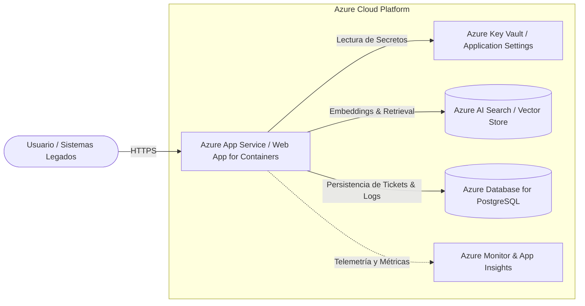

# Documento de Arquitectura y Decisiones Técnicas

Este documento formaliza la arquitectura del sistema, el flujo de procesamiento de información, las decisiones de diseño adoptadas y la estrategia de despliegue sobre Microsoft Azure.

---

## 1. Objetivos Arquitectónicos

1. **Desacoplamiento:** Separar de forma tajante la capa de transporte (FastAPI REST), la capa de orquestación de agentes (LangGraph), la capa de recuperación de conocimiento (RAG) y la capa de datos.
2. **Determinismo:** Limitar el comportamiento probabilístico de los LLMs mediante validación estricta de esquemas (Pydantic), tool calling supervisado y umbrales mínimos de similitud vectorial.
3. **Observabilidad:** Facilitar auditoría en tiempo real registrando tiempos de inferencia, tokens estimados y nombres de herramientas ejecutadas en cada petición.

---

## 2. Flujo de Datos y Razonamiento

```text
[Consulta Entrante]
        │
        ▼
[FastAPI /api/v1/chat] ────▶ [Filtro Sanitizador & Validaciones]
                                        │
                                        ▼
                        [Agente / Orquestador LangGraph]
                                        │
            ┌───────────────────────────┴───────────────────────────┐
            ▼                                                       ▼
[Condición: Requiere Manuales]                         [Condición: Requiere Acción]
            │                                                       │
[Vector Store Retrieval]                                    [Tool Invocation]
  - Query Embedding                                           - get_ticket_status
  - Similarity Search (Top-3)                                 - calculate_sla_priority
  - Context Assembly                                                │
            │                                                       │
            └───────────────────────────┬───────────────────────────┘
                                        ▼
                            [Síntesis con LLM Fundamentada]
                                        │
                                        ▼
                        [Respuesta JSON + Citas de Fuentes]
```

---

## 3. Decisiones Técnicas Clave

### A. Framework Backend: FastAPI
* **Razón:** Asincronía nativa (`async/await`), rendimiento de primer nivel (basado en Starlette y Pydantic), y generación automática de especificaciones OpenAPI/Swagger, fundamental para la evaluación técnica.

### B. Pipeline RAG: Chunking Semántico y Búsqueda Vectorial
* **Chunk Size:** 600 caracteres con solapamiento (overlap) de 80 caracteres. Esto asegura que la información técnica de los manuales (procedimientos paso a paso) conserve el contexto de los encabezados sin diluir el vector resultante.
* **Vector Store:** Implementación basada en **Chroma** en memoria/disco local para la entrega del artefacto empaquetado, encapsulada mediante una interfaz abstracta que permite la sustitución transparente por **Azure AI Search** o **pgvector** en entornos productivos.

### C. Estrategia de Agente: Function Calling
* En lugar de agentes reactivos libres propensos a alucinación o bucles infinitos, se implementa una arquitectura basada en **selección explícita de herramientas (Tool Calling)** donde el modelo recibe la firma tipada de las funciones y decide si invocar el RAG o las herramientas de tickets.

---

## 4. Estrategia de Despliegue en Microsoft Azure

La arquitectura está concebida para operar en el ecosistema de Microsoft Azure de forma nativa:



### Componentes Mapeados en Azure:
1. **Cómputo (Backend API):**
   * **Servicio:** *Azure App Service (Linux B1 / Basic Tier)* o *Azure Container Apps*.
   * **Implementación:** La aplicación se empaqueta como contenedor Docker (`Dockerfile`) y se despliega directamente configurando el puerto `8000`.
2. **Gestión de Secretos y Configuración:**
   * Las variables (`OPENAI_API_KEY`, conexiones de base de datos) se inyectan a través del panel **Configuration > Application settings** del App Service, manteniéndolas fuera del repositorio.
3. **Escalabilidad del Almacén Vectorial:**
   * En producción a gran escala, la capa vectorial local se migra a **Azure AI Search** (con indexación híbrida: búsqueda semántica + búsqueda por palabras clave BM25).
4. **Persistencia de Datos Legados y Auditoría:**
   * Despliegue sobre **Azure Database for PostgreSQL (Flexible Server)** con políticas de seguridad a nivel de fila (RLS).

---

## 5. Consideraciones de Seguridad y Resiliencia en Producción

* **Mitigación de Prompt Injection:** Se aplican dos barreras: (1) sanitización sintáctica de entradas para descartar comandos típicos de anulación de instrucciones y (2) prompts de sistema estrictos con delimitadores (`<context>`, `<question>`).
* **Manejo de Errores y Timeouts:** Todas las llamadas al proveedor de LLM cuentan con límite de tiempo de espera (timeout de 10 segundos) y reintentos exponenciales con jitter.
* **Control de Costos:** Se implementa un modelo liviano (`gpt-4o-mini`) para la síntesis rutinaria y se limitan los tokens de salida a un máximo de 500 tokens por consulta.